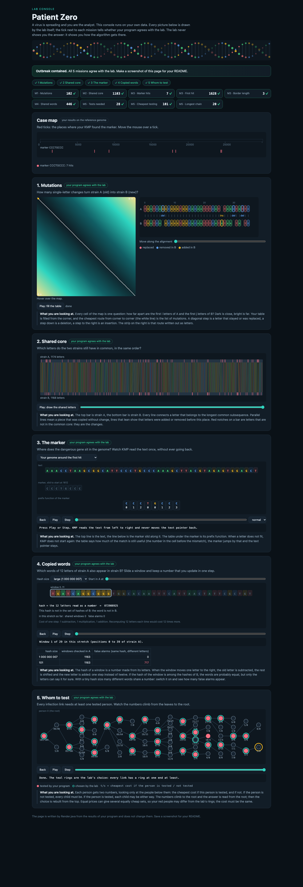

# Assignment 4. Patient Zero

Student ID: 253109
Name:
Group:

This file is the report. Fill it in as you go. How to start: `START_HERE.md`. The task: `docs/Assignment4.pdf`.

## Program output

The 9 lines your program prints on your data (`java -cp out Main`):

    Mutations: 102
    Shared core: 1103
    Marker hits: 7
    First hit: 1628
    Border length: 3
    Shared words: 446
    Tests needed: 28
    Cheapest testing: 101
    Longest chain: 20

My outbreak report (a screenshot of `output/outbreak.html`):

## Questions

Answer in your own words, two or three sentences each.

Mission 1. What does the cell d[i][j] of your table mean, and how is it computed from other cells?

The cell d[i][j] stores the minimum cost to turn the first i letters of A into the first j letters of B. I take the cheapest of deleting from A, inserting into A, and matching or replacing the final letter using the diagonal cell.

Mission 2. How is the longest common subsequence different from the longest common substring? My Shared core is bigger than the number of letters that are the same at the same place: why?

A common substring must be contiguous, but a subsequence can skip letters in either strain. An insertion can shift all later letters by one position, so LCS can still match those letters in order.

Mission 3. What does the prefix function tell you, and why does the pointer in the text never go back in KMP? What is the Border length of my marker and what does it mean?

pi[i] gives the longest proper prefix of the marker segment ending at i that is also its suffix. When a mismatch occurs, KMP uses that information to shorten the matched prefix while keeping the current text position. My marker CCCTGCCC starts and ends with CCC, so its border length is 3.

Mission 4. Why must you compare the letters after the hashes are equal? What happens to the cost of Rabin-Karp if many windows have the same hash?

Different windows can have the same hash, so I compare their letters before counting a match. If many candidates land in one bucket, each window may need to check many candidates and each comparison can take up to k steps.

Mission 5. What are the two states of a person in your DP, and how do you get the answer for a person from its children? Why does a greedy "test the person with most links first" not always give the cheapest answer?

take[v] is the minimum cost for the subtree when v is tested, and skip[v] is the minimum when v is skipped. A tested node lets each child take its cheaper state, while a skipped node forces each child to be tested. In a star with three leaves costing 1 each and a center costing 10, the highest-degree choice costs 10 but the three leaves cost 3.

## AI use

I used OpenAI Codex to generate a draft implementation of missions 1–5, run the supplied checks and benchmark, and draft the report and defense notes.

## Timing (Mission 7)

Milliseconds, average of 3 runs, from `java -cp out Bench`.

| test | size | time |
|---|---|---|
| naive search | 20 000 / 40 000 / 80 000 | 30.5 / 73.0 / 149.7 |
| KMP | 20 000 / 40 000 / 80 000 | 2.2 / 1.5 / 0.4 |
| edit distance | 500 / 1000 / 2000 / 4000 | 5.9 / 4.0 / 15.3 / 60.9 |

Doubling the text made naive search about 2.4× and then 2.1× slower with a fixed pattern size. KMP finished much faster, but the tiny measurements decreased as the JVM warmed up, so the measured ratios do not establish scaling. Doubling both strain lengths from 1000 to 2000 and from 2000 to 4000 made edit distance about 3.8× and 4.0× slower.

## Complexity

n is the length of the text (or of a strain), m the length of the pattern, k the length of the window, v the number of people. Fill in every algorithm you wrote.

| algorithm | time | space | assumptions |
|---|---|---|---|
| Edit distance | O(ab) | O(ab) | a and b are strain lengths |
| LCS | O(ab) | O(ab) | Same table dimensions |
| Prefix function and KMP | O(n + m) | O(m + h) | h is the number of hits |
| Rabin-Karp (shared words) | O(a + b + kC) expected with constant-time map lookups | O(b) | C is the number of candidate comparisons, up to (a-k+1)(b-k+1) |
| Tree DP | O(v) | O(v) | Tree with v−1 links, including DFS stack |

## Before you submit

- The four files in `data` and the screenshot `output/outbreak.png` are in the repository.
- `java tools/Check.java` shows all examples right.
- This README is filled in, the program output and the section AI use included.
- The work is pushed to main (at least one commit per mission) and the repository is public.
- The link is attached in Moodle.
